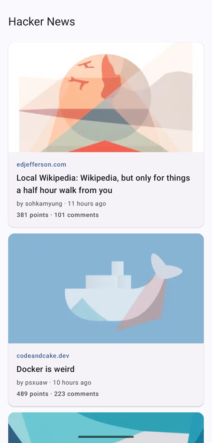
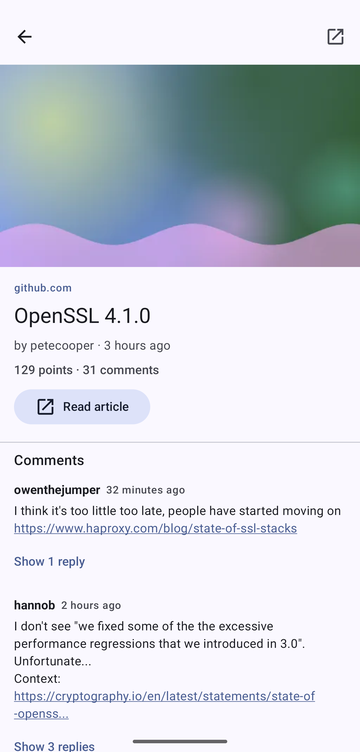
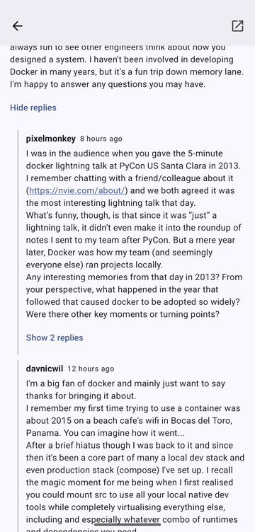
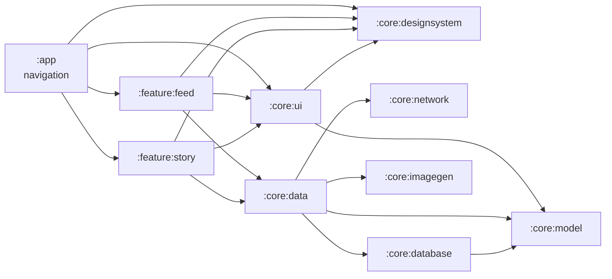

# HN Visual Feed

[](https://github.com/emirkuljanin/hn-visual-feed/actions/workflows/ci.yml)

A personal project: the Hacker News reader I want on my own phone. It shows top stories as an endless feed of
image cards. Each story gets a picture generated from its title, on the device at once and by a cloud text-to-image
model when the free quota allows. Stories, comments and pictures are stored locally, so it works offline.

| Feed (cloud thumbnails) | Story (on-device art) | Comments |
| --- | --- | --- |
|  |  |  |

What comes next is in the [roadmap](docs/roadmap.md).

## Try it

Download the APK from the [latest release](https://github.com/emirkuljanin/hn-visual-feed/releases/latest). It needs
Android 8.0 or newer on an arm64 or x86_64 device, and it is debug-signed, so uninstall any build from another
machine first. The current release, v1.0.0, does not have the wide-screen layouts yet.

Release and CI APKs show on-device art only: cloud pictures need your own free Cloudflare token (see
[Optional: cloud thumbnails](#optional-cloud-thumbnails)).

## Features

- **Top stories, endlessly**: Paging 3 with a `RemoteMediator` over Room. Pages load as you scroll; pull to
  refresh; the order stays stable while you read.
- **A picture for every story**: on-device art right away (a sentence embedding of the title painted as abstract
  shapes), upgraded to a FLUX.1 image on Cloudflare Workers AI as the free daily quota allows, best stories
  first. A title safety filter keeps some topics on device.
- **Story and comments**: the story with its full comment tree. Top-level comments load as you scroll, replies
  when you expand them.
- **Offline first**: the latest feed, as far as you scrolled since the last refresh, and the comments you loaded stay
  readable without a connection. The app says when it is offline and retries what failed when the connection returns.
- **Details**: the thumbnail flies from the card into the story (shared element transition, also with predictive
  back); TalkBack support; layouts that hold up at the largest font size and on wide screens; dark theme and
  Material You colours.

### Known limitations

- Public APKs never show a cloud image, because the Cloudflare token cannot ship in them. The cloud tier is on its
  way out (see the [roadmap](docs/roadmap.md)).
- Top stories only: no other HN lists, search, saved stories or read state.
- Nothing syncs in the background, and a refresh replaces the list: older stories are no longer reachable from the
  feed, and are deleted a week after they leave the top stories.
- Poll options are not shown, and articles open in the external browser.

## Building

Requirements: Android Studio (or any JDK 17+ to start the wrapper) and Android SDK 37. The Gradle daemon runs
on JDK 25 ([`gradle/gradle-daemon-jvm.properties`](gradle/gradle-daemon-jvm.properties)) and Gradle downloads it
if it is missing.

```bash
./gradlew assembleDebug          # build
./gradlew spotlessCheck          # formatting (ktlint + Compose rules); spotlessApply to fix
./gradlew testDebugUnitTest      # JVM unit tests (runs screenshot tests without comparing)
./gradlew verifyRoborazziDebug   # screenshot tests compared with src/test/screenshots (recordRoborazziDebug to update)
./gradlew lintDebug              # Android lint
./gradlew connectedDebugAndroidTest  # UI tests on a device/emulator
```

### Optional: cloud thumbnails

Without credentials every thumbnail is generated on device. To use FLUX.1 [schnell] on Cloudflare Workers AI,
create a free Cloudflare account and an API token from the **Workers AI** template, and add both to
`local.properties` (gitignored) or the environment:

```properties
CLOUDFLARE_ACCOUNT_ID=your-account-id
CLOUDFLARE_API_TOKEN=your-token
```

The free tier is 10,000 neurons a day, about 170 images. Use a token scoped to Workers AI only: it is compiled
into the APK, so anyone with the APK can extract it (see
[Image generation](docs/decisions.md#image-generation-coreimagegen)).

## Architecture

**UI (Compose) → ViewModel → Repository → data sources.** Room is the single source of truth: the network and
the image generators only write into it, and screens observe it, which is what makes the app work offline.
Background work (thumbnails) runs in WorkManager.



The graph shows every project dependency of the production code except `:core:common` (injected dispatchers and
clock), which `:core:data`, `:core:database`, `:core:network` and `:core:imagegen` use; `:core:testing` holds the
shared fakes and is only a test dependency. `:core:network` and `:core:imagegen` do not depend on `:core:model`:
the network layer has its own DTOs, and the image generator deliberately knows nothing about stories, so it
reports its own `ImageSource` enum, which `:core:data` maps to the model's `ThumbnailSource`. The rules agents
and humans follow are in [`AGENTS.md`](AGENTS.md).

### Modules

| Module | Responsibility |
| --- | --- |
| `:app` | Application, Hilt entry point, navigation (Navigation 3) |
| `:core:common` | Cross-cutting utilities: injectable coroutine dispatchers and `Clock` |
| `:core:data` | Repositories, the Paging `RemoteMediator`, comment loading and the thumbnail pipeline: write into Room |
| `:core:designsystem` | Material 3 theme and the injected clock for Compose; knows no domain types |
| `:core:imagegen` | Story thumbnails: cloud text-to-image, on-device embedding + procedural art, safety filter |
| `:core:model` | Pure Kotlin domain types (`Story`, `Comment`), shared by the data, database, UI and feature modules |
| `:core:network` | Hacker News API client (Retrofit + kotlinx.serialization) |
| `:core:database` | Room database: cached stories, the top-stories snapshot, thumbnail state and comment trees |
| `:core:testing` | Test-only: shared fakes, test data with a fixed "now", `MainDispatcherRule` |
| `:core:ui` | Composables shared by features: story thumbnail and metadata, load states, `PreviewTheme` |
| `:feature:feed` | The story feed screen: cards, load states, pull-to-refresh |
| `:feature:story` | A story with its comment tree: header, nested comments loaded on demand |
| `build-logic` | Convention plugins (SDK levels, Compose, Hilt, Room, Roborazzi, Kotlin options) |

Modules arrive with the PRs that need them, so no module exists without code in it.

### Tech stack

Kotlin 2.4, AGP 9 (built-in Kotlin), Gradle 9.8, Jetpack Compose + Material 3, Hilt (KSP), Coroutines,
Retrofit 3 + OkHttp 5 + kotlinx.serialization, Room 3, Paging 3, Navigation 3, WorkManager, Coil 3, MediaPipe Tasks
(text embedder), Cloudflare Workers AI. Tests: JUnit4, kotlinx-coroutines-test, Turbine, MockWebServer,
Robolectric, paging-testing, work-testing, Hilt testing, Compose UI tests, Roborazzi. All dependency versions
live in [`gradle/libs.versions.toml`](gradle/libs.versions.toml); Dependabot proposes updates weekly.

## Further reading

- [Decisions and trade-offs](docs/decisions.md): why the code is the way it is, by area.
- [On-device diffusion](docs/on-device-diffusion.md): the investigation into fully on-device text-to-image, and why
  it was dropped.
- [Roadmap](docs/roadmap.md): where the project goes next, and the known follow-ups.

## Testing

| Kind | Where | Runs on |
| --- | --- | --- |
| Unit tests: network (MockWebServer), DAOs and repositories (in-memory Room), Paging (`asSnapshot`), ViewModels, workers, image pipeline | each module's `src/test` | JVM + Robolectric |
| Compose UI tests of each screen | `feature/*/src/test` | Robolectric |
| App-level UI tests: the real app with Hilt and fake repositories (navigation, back, recreation, offline, the transition) | `app/src/test` | Robolectric |
| Screenshot tests (Roborazzi): every screen state, light and dark, offline, largest font, landscape, a frame of the transition | `*/src/test/screenshots` | Robolectric |
| Database migrations, the real MediaPipe model, one real Cloudflare call (opt-in) | `*/src/androidTest` | device or emulator |

The `verify-build` skill (`.claude/skills/verify-build`) lists the full check sequence used before every PR.

### CI and releases

GitHub Actions ([`.github/workflows`](.github/workflows)) runs the same checks on every pull request and every
push to `master`:

- **Checks**: formatting, lint (no issues allowed, warnings included), all JVM and Robolectric tests, screenshot
  verification, debug and release builds, with Kotlin warnings as errors. The release APK is kept as a build
  artifact; reports and screenshot diffs are uploaded when something fails.
- **Instrumented tests** on an API 35 x86_64 emulator: database migrations and the real MediaPipe model.
- **Releases**: pushing a `v*` tag on `master` attaches the release APK and its R8 mapping file to a GitHub Release
  (a tag like `v1.1.0-rc1` makes a pre-release); the app reports the tag as its version. The APK is R8-minified
  and debug-signed so it installs without a keystore, but each build machine has its own debug key: to switch
  between a release, a CI artifact and your own build, uninstall first.
- **Supply chain**: actions pinned to commit SHAs, Dependabot for actions and the library and plugin versions, read-only tokens,
  and the release build runs in a job that cannot write to the repository.

CI has no Cloudflare credentials on purpose: a token compiled into a public APK can be extracted. CI-built APKs
therefore show on-device art only; a build with cloud pictures needs your own account (see *Optional: cloud thumbnails*).

## How it was built

The code was written with an AI coding agent (Claude Code) under human review, set up so the results are
reviewable and repeatable rather than one-off:

- **[`AGENTS.md`](AGENTS.md)** holds the architecture rules, conventions and commands every agent (and human)
  follows; **[`.claude/project-brief.md`](.claude/project-brief.md)** the scope, agreed decisions and the
  history of the planned work.
- **Skills** in `.claude/skills`: project workflows (`verify-build`, `open-pr`) and official Android skills from
  Google (`agp-9-upgrade`, `edge-to-edge`, `navigation-3`; see [`THIRD_PARTY.md`](.claude/skills/THIRD_PARTY.md)).
- **A reviewer agent** (`.claude/agents/pr-reviewer.md`) reviews every branch before it becomes a PR. Its findings
  are fixed or answered, then reviewed again, and listed in the commit's "Pre-review" section.
- **One PR per planned task**, each reviewed and merged by a human before the next one starts; each commit message
  explains the decisions in it and what its review found. PRs 1-8 were
  reviewed on a self-hosted Gitblit server (the "Merged #n" commits by `admin`); GitHub from PR 9 on, followed by
  two audit PRs ([#3](https://github.com/emirkuljanin/hn-visual-feed/pull/3),
  [#4](https://github.com/emirkuljanin/hn-visual-feed/pull/4)).
- **CI** (GitHub Actions) repeats the agent's local checks on every PR, so "it passed on my machine" is not the
  last word.
