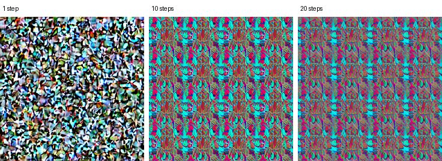

# On-device diffusion: investigated, then dropped

PR 8 was meant to add an opt-in, fully on-device text-to-image model as a third thumbnail tier, for
stories the cloud quota does not reach. This document records what was tried on a real device, what was established
and why the feature was dropped. Nothing of it ships in the app; the thumbnail pipeline was built so it could be added
later (see [What it would take](#what-it-would-take)).

**Summary**: Google's MediaPipe Image Generator was made to run on a Pixel 7 Pro after working around three
problems in the library, and then produced only noise. A byte-for-byte check against the official Stable Diffusion
weights showed the model is exactly what Google's converter produces, which by elimination points to MediaPipe's
(no longer maintained) OpenCL
engine on this phone's Mali GPU and driver. Of the other on-device options found, one is plausible
(stable-diffusion.cpp on the CPU with a one-step model), but it needs a native build and its speed on this hardware
is unknown, so it was not worth the risk.

## The plan

- Opt-in in a settings screen, with a warning (download size, battery, heat) and a permission-free requirements
  check: arm64, RAM, free storage, GPU library present, thermal state.
- Download the model once over an unmetered network, verify it against a pinned SHA-256, resume if interrupted.
- A `DiffusionImageGenerator` behind the existing `ImageGenerator` interface, listed after the cloud generator in
  `TieredThumbnailGenerator`'s upgrades. It has no daily quota, so it would take over when Cloudflare's runs out.
- Generation in the background whenever the battery is not low (the user's choice over "only while charging").

Decided with the user before writing code: the engine (MediaPipe, a Maven library with a Kotlin API, over
stable-diffusion.cpp, which needs a native build) and the model source (a community conversion pinned by checksum,
over converting and hosting it ourselves).

## The device

Pixel 7 Pro (`cheetah`): Google Tensor G2 (GS201), Mali-G710 GPU, 12 GB RAM, Android 16. The vendor OpenCL library
is exposed to apps (`/vendor/lib64/libOpenCL.so` and `libOpenCL-pixel.so` are listed in
`/vendor/etc/public.libraries.txt`), which MediaPipe's GPU path requires (`<uses-native-library>` in the manifest).
This was the only device tested.

## The model

MediaPipe needs Stable Diffusion 1.5 converted into one raw fp16 `.bin` file per tensor. Google shipped a converter
(`tools/image_generator_converter/convert.py` in mediapipe-samples, removed in February 2026) but never a converted
model.

- Source: [`cuesetac/sd15-mediapipe`](https://huggingface.co/cuesetac/sd15-mediapipe) on Hugging Face
  (`sd15-mediapipe.zip`, 2,067,658,596 bytes, uploaded 2026-10-05, CreativeML OpenRAIL-M).
- Integrity: SHA-256 `b8de2f5c339b63d9b9fb6c17d56b73128597e1189bda43965d86bc829b3cfc96`, equal to the hash Hugging
  Face publishes for the file. A stored (uncompressed) zip of 1,040 files: 1,039 fp16 tensors and the CLIP
  vocabulary (byte-identical to OpenAI's `bpe_simple_vocab_16e6.txt`).
- Correctness, established later (see below): byte-identical to a fresh conversion of the official weights.

## What happened

### 1. A broken library release

`com.google.mediapipe:tasks-vision-image-generator` was last released as 0.10.26 and 0.10.26.1. Google removed its
samples in February 2026 ([mediapipe-samples `643457b`](https://github.com/google-ai-edge/mediapipe-samples/commit/643457b),
"Remove no longer supported Image Generation samples") and has since removed the Image Generator pages from the
MediaPipe documentation (the Android guide now ends in a 404, while sibling tasks' pages still load). Creating a
generator failed at once:

```
java.lang.NoSuchMethodError: No virtual method build()Lcom/google/protobuf/Any;
    in class Lcom/google/protobuf/Any$Builder
```

The bytecode (`javap`) shows why: 0.10.26 and 0.10.26.1 call `Any$Builder.build()` with the signature of the
**full** protobuf runtime, while MediaPipe's own `tasks-core` depends on **protobuf-javalite** 4.26.1, whose
`Any.Builder` only inherits `build()`. The releases checked from 0.10.9 to 0.10.21 make the lite call. Workaround:
substitute `protobuf-java` for `protobuf-javalite` (the full runtime also contains the lite classes).

### 2. One MediaPipe version for the whole app

The app's text embedder (the on-device art) uses MediaPipe 1.1.1, and Gradle resolves the shared `tasks-core` to one
version for the whole app. Mixing the image generator 0.10.26.1 with `tasks-core` 1.1.1 hit the same protobuf error,
so rather than test that mix further I aligned every MediaPipe artifact on one version. That means
downgrading the shipping text embedder from 1.1.1, with a cost either way:

| Version | Problem |
| --- | --- |
| 0.10.26.1 | The protobuf bug above; its `tasks-text` has no x86_64 library (the text embedder would stop working on the emulator) |
| 0.10.21 | Its native libraries are aligned to 4 KB pages, so they are not 16 KB page compatible, which Google Play requires for apps targeting Android 15+ |

### 3. Two native runtimes cannot share a process

With the versions aligned and the protobuf workaround in place, generating after the text embedder had run failed:

```
MediaPipeException: not found: ValidatedGraphConfig Initialization failed.
No registered object with name: mediapipe::tasks::vision::image_generator::ImageGeneratorGraph
```

Each MediaPipe artifact bundles its own copy of the framework's native code. Whichever library loads first serves
the shared JNI methods, and the text library does not register the image generator's graph. The feature would have
needed its own process (a bound service in `android:process=":diffusion"`), which would also have kept its memory
(an estimated 2–3 GB; the fp16 weights alone are about 2 GB) and any native crash away from the app. All runs below
were in a fresh process with only the image generator loaded.

### 4. A storage permission detour

The first run in a clean process crashed natively (`SIGSEGV`, null pointer in `ml_drift::TextGuidanceBuilder`):
the weights had been pushed with adb into the app's external files directory, where the app's own user cannot read
files that adb wrote (even `run-as` got "Permission denied"). Copying them into the app's private storage through
`/data/local/tmp` fixed it. In the shipping design the app would download the model itself, so this only affects
testing, but it is a good example of reading a native crash backwards to its cause.

### 5. It runs, and draws noise

| Step | Time on the Pixel 7 Pro |
| --- | --- |
| Load the model (`createFromOptions`) | 25.8 s |
| 1 step | 3.4 s |
| 10 steps | 20.3 s |
| 20 steps | 40.2 s |

Output is 512×512, about 2 s per step. With the one prompt tried (the app's cloud prompt for "Rust support lands in
the Linux kernel", seed 42), the 10- and 20-step images are a regular tiled pattern. The 1-step image is
unstructured noise, which proves little on its own: Stable Diffusion 1.5 needs many steps even on a working engine.



A repeating lattice rather than a blurry or wrong picture suggests a systematic compute error (for example a layout
or stride bug in a GPU kernel) rather than bad weights.

### 6. Model or engine?

The suspects, and what was done about each:

- **Protobuf substitution**: version 0.10.21 needs no substitution and produced the same noise pattern. Ruled out.
- **Process state** (section 3): the noise runs were in a clean process with only the image generator loaded.
  Ruled out.
- **The model**: tensor sizes match fp16 (for example the CLIP token embedding: 49,408 × 768 × 2 bytes) and values
  are sensible (`alphas_cumprod` starts at 0.999 and ends at 0.0047). Then the official weights
  (`v1-5-pruned-emaonly.safetensors`, 4,265,146,304 bytes, SHA-256 `6ce01616…806fa2fa`; the safetensors file rather
  than the pickled `.ckpt`, which can run code when loaded) were converted with `convert.py`'s logic re-implemented
  in numpy (every tensor except the VAE encoder, cast to fp16, one file per key). **All 1,039 tensors were
  byte-identical** to the community download, which also shows the re-implementation is faithful. The only inf
  value in the model is `model_ema.num_updates`, a training counter inference does not use. Ruled out: the community
  file is exactly what Google's method produces.
- **Converter vs engine format**: the converter was removed with the samples, so it is unverified that its output
  still matches what 0.10.26 expects. Unlikely to be the cause, since 0.10.21 draws the same pattern.
- **Engine or driver**: what remains is MediaPipe's engine (`ml_drift`), which runs only on OpenCL, through Pixel's
  vendor driver. That driver ships with OS updates, and Android 16 postdates the generator's last release, so with
  one device an engine bug and a driver regression look the same. Other projects treat the driver as a variable
  too: PixelDream re-enables its GPU path after Android updates.

Not tested: another device or GPU, other prompts and seeds. The conclusion is therefore by elimination: the fault
points to MediaPipe's OpenCL engine on this GPU and driver. It is not a general "diffusion cannot work on Mali":
another engine produces clean images on the next Mali generation (below).

## Other options

| Option | Finding |
| --- | --- |
| stable-diffusion.cpp on the GPU (Vulkan, OpenCL) | Vulkan crashed on a Mali-G68 and in Adreno's shader compiler ([llamadart #776](https://github.com/leehack/llamadart/issues/776)). [PixelDream](https://github.com/chartmann1590/pixeldream/pull/56) patched a Mali crash and gets clean SD 1.5 on a Pixel 8 Pro's Mali-G715: 20 steps in 736 s on the GPU against 1,712 s on the CPU. It also checks GPU output for noise and falls back to the CPU |
| ML Kit GenAI (Gemini Nano) | Understands images (description, multimodal prompts) but does not generate them ([release notes](https://developers.google.com/ml-kit/release-notes)) |
| Qualcomm NPU apps ([local-dream](https://github.com/xororz/local-dream), Off Grid) | Snapdragon only. local-dream's CPU fallback uses Alibaba's [MNN](https://github.com/alibaba/MNN), which would have to be built from source; local-dream itself is [CC BY-NC 4.0](https://github.com/xororz/local-dream/blob/master/LICENSE) |
| LLM-based generators ([Janus-Pro](https://arxiv.org/pdf/2501.17811) 1B) | Runs in a browser on WebGPU; no Android runtime, and autoregressive generation is slow |
| Mobile-optimised models (MobileDiffusion, SnapFusion, SnapGen++) | Papers with phone timings, but no released weights found |
| ExecuTorch, LiteRT | General runtimes; no maintained Stable Diffusion example for Android found |
| **stable-diffusion.cpp on the CPU with a one-step model** | **Plausible**: SDXS takes 6.1 s on a Galaxy S24's CPU ([stable-diffusion-native #2](https://github.com/leehack/stable-diffusion-native/issues/2)) and 26–29 s on a Galaxy A53 (llamadart #776). Not measured on the Pixel |

## What it would take

The plausible path, and how it would fit the existing code:

- **Runtime**: [stable-diffusion-native](https://github.com/leehack/stable-diffusion-native) publishes MIT-licensed
  prebuilt stable-diffusion.cpp libraries, including Android arm64 (v0.3.0: a 37 MB `.so`, about 15 MB compressed,
  CPU only on purpose, with `SHA256SUMS`). It needs ARMv8.2 dot-product and fp16 instructions (check for `asimddp`
  and `asimdhp` before loading).
- **Bridge**: its C API takes large structs, so it needs a small JNI shim built with the NDK and CMake. That adds a
  native build to the project and to CI.
- **Model**: [SDXS-512 Q8_0 GGUF](https://huggingface.co/concedo/sdxs-512-tinySDdistilled-GGUF), 683 MB,
  OpenRAIL++, one step, peaking at 1.35–1.55 GB of memory on Android phones (llamadart #776). SD-Turbo makes nicer images, but it
  is 1.9 GB, was killed by the low-memory killer on a Galaxy A53, and its
  [licence](https://huggingface.co/stabilityai/sd-turbo/blob/main/LICENSE.md) (the Stability AI Community License)
  allows commercial use only with registration, a revenue cap and a "Powered by Stability AI" notice.
- **Speed**: the 6.1 s figure is from a Galaxy S24 (Adreno 750, so the Snapdragon 8 Gen 3 model). The A53 takes 26–29 s, and PixelDream measured a
  Tensor G3's CPU at 1,712 s for 20-step SD 1.5. A one-step SDXS image on the Tensor G2 is likely to be well
  above the S24's time; it would have to be measured before committing.
- **Safety**: a diffusion model can depict things, and Cloudflare's server-side moderation would not apply.
  `DiffusionImageGenerator` would have to apply the same title filter as the cloud generator, which would be the
  only filter (stable-diffusion.cpp has no safety checker).
- **Concurrency**: the pipeline runs two upgrades in parallel (`UPGRADE_PARALLELISM`); the generator would need a
  mutex so only one model sits in memory.
- **Process isolation**: not required (it shares no native code with MediaPipe), but still worth considering to
  keep 1.5 GB and any native crash out of the app's process.
- **App integration**: `DiffusionImageGenerator` after the cloud generator in `TieredThumbnailGenerator`; the
  pipeline would need to skip only the quota-limited generator during a quota pause (today the pause stops all
  upgrades), and to cap each worker run so long CPU generations stay inside WorkManager's 10-minute window.
  Settings screen, requirements check, pinned and resumable download as planned.
- **Cost**: about 15 MB more to download and 37 MB more installed per arm64 APK for an opt-in feature (Play Feature Delivery would make it
  an on-demand module), a native build, and unknown image quality and speed on Tensor until measured.

## Why it was dropped

- Google's own path (MediaPipe) does not work on the target device, by elimination its engine on this GPU and
  driver, and Google has stopped maintaining it.
- The remaining path adds a native build, a third-party runtime and a 683 MB download for an image quality and speed
  nobody had seen on this hardware.
- Every story already gets a picture: on-device art at once, cloud images as the free quota allows. A third tier
  would improve the long tail, not fix a gap.

## Lessons

- **Spike before building**: one instrumented test on a real device answered in an evening what would otherwise
  have surfaced after a settings screen, a download manager and a pipeline change were written.
- **Narrowing down a failure with several suspects**: library version, protobuf runtime, process, storage
  permissions, model, converter, engine and driver, each ruled in or out with a specific experiment where possible
  and named as untested where not. The byte-for-byte reconversion settled "maybe the model is bad" (it is not); MediaPipe's
  OpenCL engine or the GPU driver is the remaining suspect, by elimination.
- **Dependency hygiene**: reading bytecode (`javap`) and ELF headers to find a mis-built release and 4 KB-aligned
  native libraries before they reached users.
- **Supply chain**: a community model pinned by SHA-256; verified against official weights in `.safetensors`, not
  pickle.
- **Licences**: CreativeML OpenRAIL-M and OpenRAIL++ carry use restrictions to pass on to users; SD-Turbo's
  community licence and local-dream's CC BY-NC add more legal surface.
- **Android realities**: GPU driver fragmentation (Mali vs Adreno, driver updates), vendor libraries behind
  `<uses-native-library>`, 16 KB pages, per-ABI native libraries and APK size, WorkManager limits for long work.
- **Knowing when to stop**: the code that shipped already gives every story a picture; the extra tier was not
  worth the risk.
